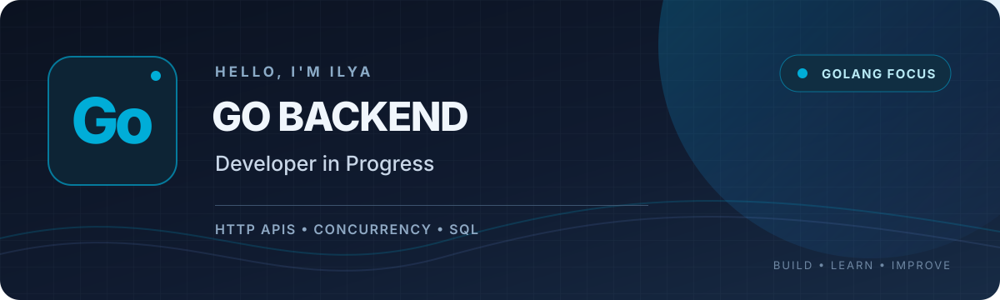

  

<h3 align="center">Go Backend Developer in Progress 🚀</h3>

  I'm Ilya — a student focused on backend development with <strong>Go</strong>.
   
  I enjoy building HTTP services, working with APIs and exploring concurrent programming.

  
  
  
  

---

## 👨‍💻 About Me

- 🎯 Main direction: **Backend Development with Go**
- ⚙️ Interested in HTTP services, REST APIs and concurrency
- 🐍 Python is an additional language I have worked with
- 🌱 Currently learning more about SQL, PostgreSQL and backend architecture

## 🧰 Tech Stack

| Area | Technologies |
|---|---|
| **Primary language** | Go (Golang) |
| **Backend** | HTTP, REST APIs, goroutines, channels |
| **Databases** | SQL; PostgreSQL — currently learning |
| **Also familiar with** | Python |
| **Tools** | Git, GitHub |

## 🚀 Featured Project

### [Task Orchestrator](https://github.com/efrilya07-eng/task-orchestrator)

A Go HTTP service for managing background tasks.

- Background task queue
- Supports sleep and HTTP check tasks
- Task state persistence in a JSON file
- Re-queues unfinished tasks after restart
- HTTP endpoints for creating tasks, checking task status and viewing statistics

**Run locally:**

~~~bash
git clone https://github.com/efrilya07-eng/task-orchestrator.git
cd task-orchestrator
go test ./...
go run .
~~~

## 📊 GitHub Stats

  
  

  <a href="https://github.com/efrilya07-eng?tab=repositories">Explore my repositories</a>

---

<em>Building. Learning. Improving.</em> 🚀

